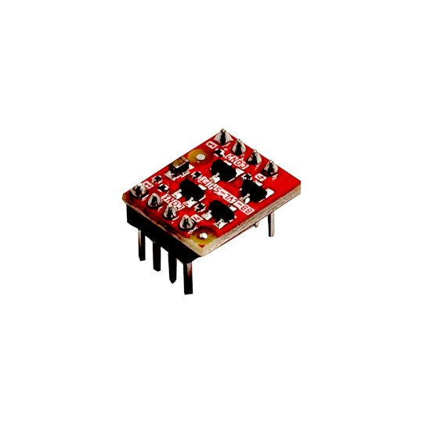

# BB-LVL-SHIFT
Breadboard friendly level shift module allow two boards with different voltages to talk with voltage levels from 1.65V to 5.5V

https://www.olimex.com/Products/Breadboarding/Components/BB-LVL-SHIFT/open-source-hardware

## Licensee
* Hardware is released under CERN Open Hardware Licence Version 2 - Strongly Reciprocal, all silkscreen credits to Bernardo Kastrup and Dean Belfield should remain;
* Software is released under MIT Licensee
* Documentation is released under CC BY-SA 3.0